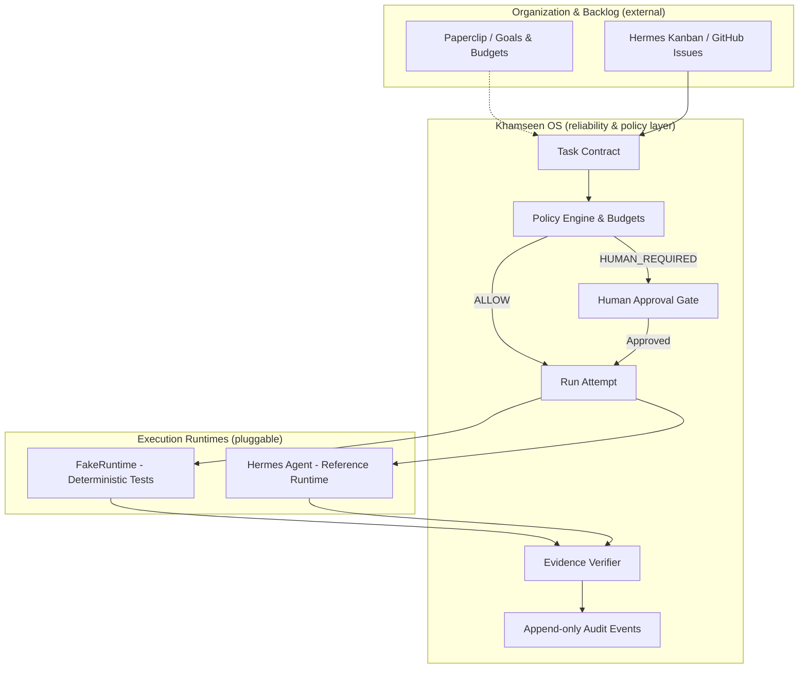

# Khamseen OS

[](LICENSE)
[](https://github.com/Fizioh/khamseen-os/actions/workflows/ci.yml)
[](#project-status)

**An open-source reliability and policy layer for autonomous AI agents.**

Khamseen OS provides portable execution contracts, deterministic policy enforcement, evidence verification, auditability, bounded autonomy, and runtime conformance tests for autonomous agent workflows.

> **Experimental alpha — minimal reliability core and reference contracts, APIs subject to change.**

## Reference stack and positioning

Khamseen OS is designed as a focused verification and policy layer rather than a monolithic agent platform:

| Layer | Reference component | Role |
|-------|---------------------|------|
| **Organization & budgets** | **Paperclip** (optional) | Company-level organization, goals, budgets, and delegation |
| **Task collaboration** | **Hermes Kanban / GitHub** | Task coordination, backlog, pull requests, and CI |
| **Reliability & policy** | **Khamseen OS** (this repository) | Execution contracts, policy gates, evidence verification, bounded loops, runtime conformance |
| **Execution runtime** | **Hermes Agent** ([NousResearch/hermes-agent](https://github.com/NousResearch/hermes-agent)) | Reference agent runtime with native tools, skills, memory, and execution |

Khamseen OS **does not** rebuild Paperclip dashboards, org charts, Hermes agent runners, memory stores, or Kanban boards. It enforces deterministic rules and evidence checks around runtime execution without requiring vendor-specific IDE or subscription dependencies.

## Quickstart (3 commands)

```bash
python -m pip install -e ".[dev]"
python examples/engineering-loop/run_example.py
pytest -v
```

See [docs/getting-started.md](docs/getting-started.md) for virtual environment setup, CLI options, and troubleshooting.

## Value proposition

- **Bounded autonomy**: enforce maximum attempts, timeouts, verified token/cost budgets, and identical-failure circuit breakers.
- **Evidence-first completion**: never mark a task complete merely because an agent claims success; require deterministic verification and independent review evidence.
- **Independent review**: separate implementer runs from reviewer verification and policy gate evaluation.
- **Explicit human authority**: enforce `HUMAN_REQUIRED` policy gates before sensitive actions execute, even when underlying CLI runtimes operate in non-interactive one-shot mode.
- **Portable runtime boundary**: test deterministically offline with `FakeRuntime` and integrate with Hermes Agent via documented adapter contracts.

## Engineering workflow lifecycle

Work moves through a bounded, auditable pipeline:

`REQUEST` → `IMPLEMENT` → `CHECK` → `REVIEW` → `REMEDIATE` → `QA` → (`HUMAN_APPROVAL`) → `DONE`

- **REMEDIATE** executes a bounded correction loop after failed checks or review findings.
- **HUMAN_APPROVAL** is enforced conditionally when task policy or tool sensitivity requires explicit human sign-off.
- Missing mandatory verification evidence causes the pipeline to **fail closed**.



## Architecture principles

1. **Agent ≠ Model** — agents are role-scoped identities; models and runtimes are replaceable execution dependencies.
2. **Task ≠ Run** — a `Task` represents requested outcome; each execution attempt creates a distinct `Run`.
3. **Claim ≠ Evidence** — agent prose is not proof; completion requires verified deterministic artifacts (`Evidence`).
4. **Review finding ≠ Policy decision ≠ Human approval** — reviewer evidence, automated policy evaluation (`ALLOW` / `DENY` / `HUMAN_REQUIRED`), and human sign-off are separate primitives.
5. **Bounded loops** — remediation retries are strictly capped and halt on repeated identical errors or budget exhaustion.
6. **External sandbox boundary** — Python policy objects enforce workflow invariants, while OS-level process, filesystem, network, and credential isolation must be enforced by an external container or sandbox runtime.

Details: [ARCHITECTURE.md](ARCHITECTURE.md), [docs/concepts.md](docs/concepts.md), [ADR-002](docs/decisions/ADR-002-runtime-portability.md).

## Open experiments and R&D

Alongside the reliability core in `src/khamseen_os/`, [docs/rnd/](docs/rnd/README.md) tracks open research protocols (such as the Agent Runtime Benchmark, Open Geospatial Agent, and Open AlphaEvolve Mini). Research protocols are explicitly labeled and kept separate from shipped package features.

## Project status

| Area | Status in `khamseen-os` | Notes |
|------|-------------------------|-------|
| Architecture & ADR contracts | ✅ Published | [ARCHITECTURE.md](ARCHITECTURE.md), [ADR-001](docs/decisions/ADR-001-public-core-private-modules.md), [ADR-002](docs/decisions/ADR-002-runtime-portability.md) |
| Reliability core (`src/khamseen_os`) | ✅ Experimental alpha | Typed contracts, bounded autonomy guards, `FakeRuntime`, manifest validator |
| Runnable engineering loop | ✅ Executable offline | [examples/engineering-loop/](examples/engineering-loop/README.md) |
| Provider conformance suite | ✅ Executable offline | 9-point `ProviderConformanceHarness` in `src/khamseen_os/conformance.py` |
| Hermes runtime adapter | ✅ Contract & fixtures | Verified `--oneshot` / `--usage-file` adapter + conformance fixtures; live CLI opt-in |
| Threat model & security tests | ✅ Published & tested | [docs/security/threat-model.md](docs/security/threat-model.md) + 12 regression tests |
| Public CI & quality gates | ✅ Active on GitHub Actions | Pytest, Ruff, Mypy, example execution, link & secret checks |

## Documentation

| Document | Purpose |
|----------|---------|
| [ARCHITECTURE.md](ARCHITECTURE.md) | System boundaries, core primitives, and reference stack |
| [ROADMAP.md](ROADMAP.md) | Open-source milestones |
| [CONTRIBUTING.md](CONTRIBUTING.md) | Development setup, workflow, and PR standards |
| [SECURITY.md](SECURITY.md) | Vulnerability reporting policy |
| [docs/getting-started.md](docs/getting-started.md) | Quickstart and local verification commands |
| [docs/concepts.md](docs/concepts.md) | Canonical vocabulary and invariants |
| [docs/module-contract.md](docs/module-contract.md) | Domain module boundary |
| [docs/contracts/task-run-states.md](docs/contracts/task-run-states.md) | Task, Run, Event, and Approval state machines |
| [docs/contracts/graphs-and-loops.md](docs/contracts/graphs-and-loops.md) | Bounded execution graphs and correction loops |
| [docs/contracts/runtime-provider.md](docs/contracts/runtime-provider.md) | `RuntimeProvider` interface and conformance specification |
| [docs/contracts/hermes-adapter.md](docs/contracts/hermes-adapter.md) | Hermes Agent reference adapter contract |
| [docs/contracts/skills-and-capabilities.md](docs/contracts/skills-and-capabilities.md) | Skills registry and capability routing contract |
| [docs/security/threat-model.md](docs/security/threat-model.md) | 12-threat autonomous agent security threat model |
| [docs/decisions/ADR-001-public-core-private-modules.md](docs/decisions/ADR-001-public-core-private-modules.md) | Public core vs private modules split |
| [docs/decisions/ADR-002-runtime-portability.md](docs/decisions/ADR-002-runtime-portability.md) | Runtime portability and Hermes reference execution boundary |

## Contributing

We welcome conformance fixtures, policy guard improvements, security regression tests, and documentation refinements. See [CONTRIBUTING.md](CONTRIBUTING.md) and [open issues](https://github.com/Fizioh/khamseen-os/issues) labeled `good first issue` or `help wanted`.

## Community acknowledgements

Thank you to our external open-source contributors:

- [@wufangyong973](https://github.com/wufangyong973) — clarified the `Agent ≠ Model` and `Task ≠ Run` vocabulary invariants in [docs/concepts.md](docs/concepts.md) ([PR #12](https://github.com/Fizioh/khamseen-os/pull/12), closing [#10](https://github.com/Fizioh/khamseen-os/issues/10)).

## License

Apache License 2.0 — see [LICENSE](LICENSE).
