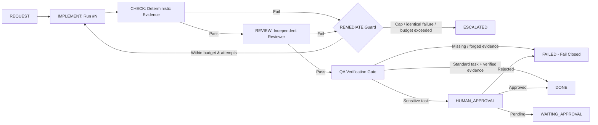

# Bounded Execution Graphs and Correction Loops

This contract defines how `khamseen_os` bounds autonomous execution loops and escalates to human authority when convergence fails.

## Graph vs loop

- **Execution graph**: Orders dependent workflow units and gates (`REQUEST` → `IMPLEMENT` → `CHECK` → `REVIEW` → `QA` → `HUMAN_APPROVAL` → `DONE`).
- **Correction loop**: Bounded remediation cycle inside a unit when verification fails (`IMPLEMENT` → `CHECK` / `REVIEW` failure → `REMEDIATE` → new `IMPLEMENT` `Run`).

## Deterministic loop bounds (`BudgetSpec`)

Every `Task` carries a `BudgetSpec` enforced by `PolicyEngine`:

1. **Maximum attempts (`max_attempts`)**:
   - Caps total `IMPLEMENT` attempts.
   - Each remediation cycle increments `attempt` and creates a fresh `Run` record.
   - Exceeding `max_attempts` produces `PolicyDecision.DENY` with rule `"max_attempts_exceeded"` and transitions the task to `ESCALATED`.

2. **Execution timeout (`timeout_seconds`)**:
   - Enforced per `Run`.
   - Any run returning `RunStatus.TIMED_OUT` or `duration_seconds > timeout_seconds` fails post-run policy with `"execution_timeout_exceeded"`.

3. **Identical failure circuit breaker (`max_identical_failures`)**:
   - Tracks normalized failure signatures (`error_code:error_message`) across failed runs.
   - When the same failure repeats `max_identical_failures` times, `PolicyEngine` halts further retries with `"repeated_identical_failure_limit_reached"` and escalates immediately rather than burning remaining attempts.

4. **Verified token and cost budgets (`max_total_tokens`, `max_cost_usd`)**:
   - Evaluated against `UsageMetrics` across all runs for the task.
   - Requires `UsageMetrics.verified == True` whenever a token or cost cap is configured; unverified usage data fails closed (`"unverified_token_usage_data"` / `"unverified_cost_usage_data"`).
   - Exceeding configured caps halts the loop with `"token_budget_exceeded"` or `"cost_budget_exceeded"`.

5. **Mandatory evidence and independent review**:
   - Agent completion claims (`Run.claimed_success = True`) never suffice on their own.
   - All `EvidenceKind` items declared in `Task.required_evidence` must be present, integrity-verified (`Evidence.verify_integrity()`), and passing.
   - `EvidenceKind.INDEPENDENT_REVIEW` must be produced by an actor with `producer_role == "reviewer"` and a `producer_id` distinct from the implementer's `agent_id`.

6. **Escalation to `HUMAN_REQUIRED`**:
   - When `Task.requires_human_approval` is `True` or `Task.sensitive_actions` is non-empty, completion (or pre-execution when configured) returns `PolicyDecision.HUMAN_REQUIRED` until a valid `ApprovalRecord(status=ApprovalStatus.APPROVED)` from an authority distinct from the implementer is recorded.
