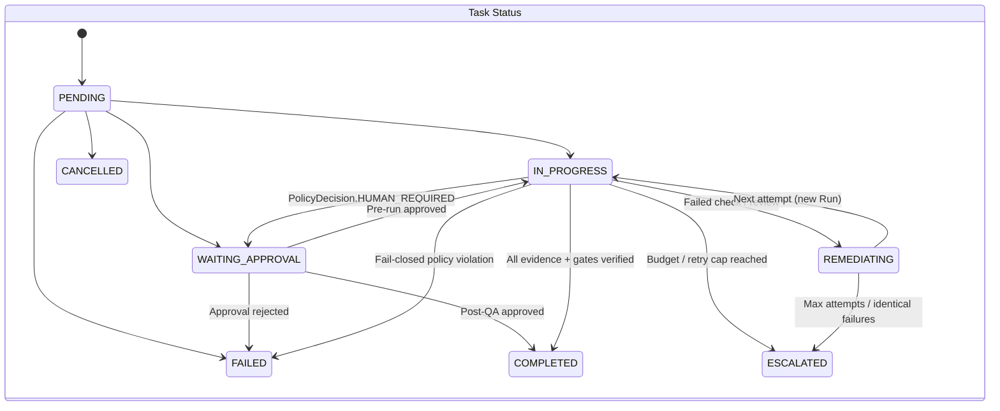
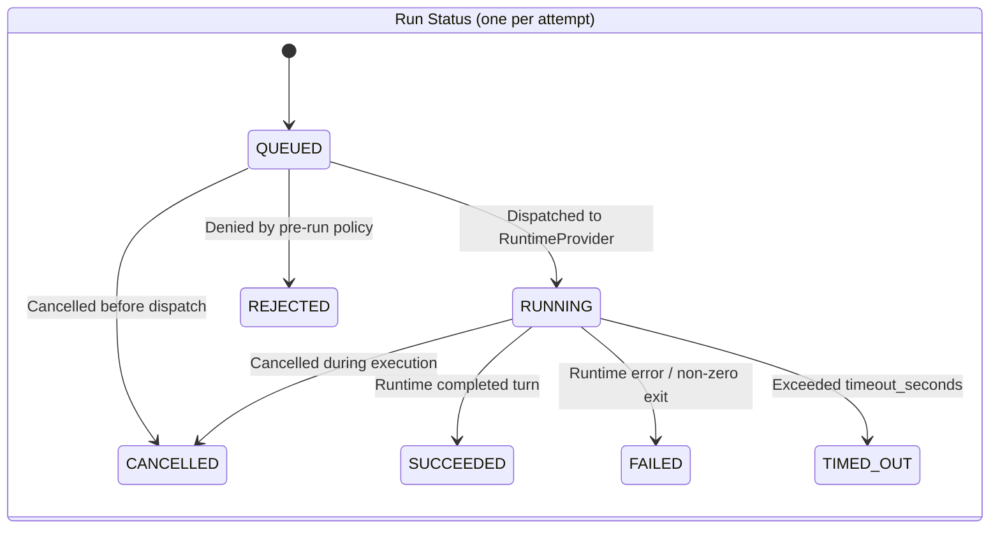

# Task, Run, Event, and Approval State Machines

This contract codifies the state machines enforced by `khamseen_os.contracts` and `khamseen_os.policy`.

## Core distinction: Task vs Run

- A **`Task`** represents the requested outcome and tracks workflow progress across the pipeline.
- A **`Run`** represents a single execution attempt against a `RuntimeProvider`.
- Every retry or remediation pass creates a **new `Run`** record; prior `Run` records remain immutable in the audit history.

## Task lifecycle stages (`LifecycleStage`)

Pipeline progression:

`REQUEST` → `IMPLEMENT` → `CHECK` → `REVIEW` → (`REMEDIATE` → `IMPLEMENT`)* → `QA` → (`HUMAN_APPROVAL`) → `DONE`

### Allowed stage transitions (`ALLOWED_STAGE_TRANSITIONS`)

| From stage | Allowed target stages | Rejection behavior |
|------------|-----------------------|--------------------|
| `REQUEST` | `PLAN`, `DELEGATE`, `IMPLEMENT`, `HUMAN_APPROVAL`, `FAILED` | Raises `UnsafeStateTransitionError` |
| `PLAN` | `DELEGATE`, `IMPLEMENT`, `FAILED` | Raises `UnsafeStateTransitionError` |
| `DELEGATE` | `IMPLEMENT`, `FAILED` | Raises `UnsafeStateTransitionError` |
| `IMPLEMENT` | `CHECK`, `REMEDIATE`, `FAILED`, `ESCALATED` | Raises `UnsafeStateTransitionError` |
| `CHECK` | `REVIEW`, `REMEDIATE`, `FAILED`, `ESCALATED` | Raises `UnsafeStateTransitionError` |
| `REVIEW` | `QA`, `REMEDIATE`, `FAILED`, `ESCALATED` | Raises `UnsafeStateTransitionError` |
| `REMEDIATE` | `IMPLEMENT`, `CHECK`, `FAILED`, `ESCALATED` | Raises `UnsafeStateTransitionError` |
| `QA` | `HUMAN_APPROVAL`, `DONE`, `REMEDIATE`, `FAILED`, `ESCALATED` | Raises `UnsafeStateTransitionError` |
| `HUMAN_APPROVAL` | `IMPLEMENT`, `DONE`, `FAILED`, `ESCALATED` | Raises `UnsafeStateTransitionError` |
| `DONE` | *(terminal — none)* | Raises `UnsafeStateTransitionError` |
| `FAILED` | *(terminal — none)* | Raises `UnsafeStateTransitionError` |
| `ESCALATED` | *(terminal — none)* | Raises `UnsafeStateTransitionError` |

Attempting to jump directly from `REQUEST` or `IMPLEMENT` to `DONE` is rejected deterministically by `transition_task_stage`.

## Review finding vs Policy decision vs Human approval

| Primitive | Representation in `khamseen_os` | Role in state transitions |
|-----------|---------------------------------|---------------------------|
| **Review finding** | `Evidence(kind=EvidenceKind.INDEPENDENT_REVIEW, passed=..., producer_role="reviewer")` | Supplies verifiable evidence from an actor distinct from the implementer. |
| **Policy decision** | `PolicyEvaluation(decision=PolicyDecision.ALLOW \| DENY \| HUMAN_REQUIRED)` | Deterministic rule evaluation over runs, budgets, and evidence records. |
| **Human approval** | `ApprovalRecord(status=ApprovalStatus.APPROVED \| REJECTED, approver_id=...)` | Explicit human sign-off required when a policy gate returns `HUMAN_REQUIRED`. |
