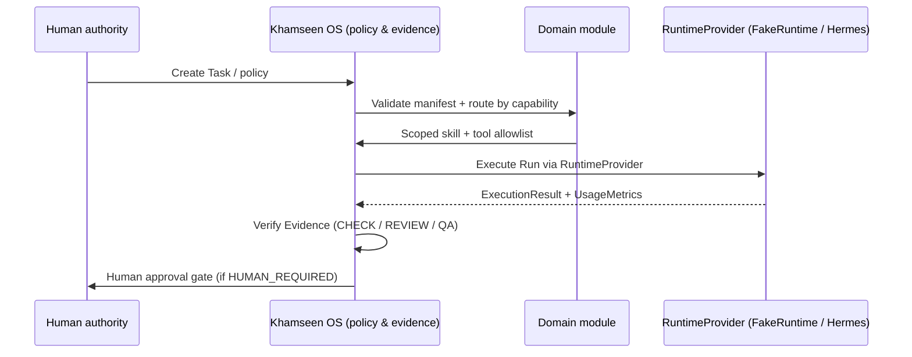

# Module contract

A **module** is a domain package that plugs into the Khamseen OS reliability and policy layer without forking core primitives.

Examples: engineering, research, operations, commerce, career, SaaS, R&D — same lifecycle, different chiefs and scopes.

## Module delivers

| Artifact | Description |
|----------|-------------|
| **Domain chief** | Top delegate for the module (`chief_role`, escalation to human authority). |
| **Role catalog** | Managers, specialists, workers (organizational, not necessarily 1:1 with graph nodes). |
| **Capability map** | Which capabilities each role may accept. |
| **Skill set** | Versioned skills (`SkillSpec`: capabilities, tool allowlists, approval requirements). |
| **Tool catalog** | Registered tools with `<namespace>.<action>` identifiers and permission scopes. |
| **Data scopes** | What data classes the module may read/write (`<resource>:<scope>`, no wildcards). |
| **Workflow templates** | Default graphs/loops for common outcomes (not mandatory for all tasks). |
| **Policy hooks** | When human approval is required for this domain (`approval_policy`). |

## Module must not

- Store secrets in the open core repository
- Embed client-specific production configuration
- Replace control-plane primitives (`Task`, `Run`, `Evidence`, `AuditEvent`, `ApprovalRecord`)
- Bypass independent review for implementer-owned work
- Invent business measurements inside LLM outputs

## Control plane ↔ module boundary

## Module manifest schema and validation

Module manifests are validated against [schemas/module-manifest.schema.json](../schemas/module-manifest.schema.json) using `validate_module_manifest` / `load_and_validate_manifest` in `src/khamseen_os/manifest.py`.

Reference engineering manifest: [examples/engineering-loop/module-manifest.json](../examples/engineering-loop/module-manifest.json).

### Validation rules enforced in CI

- All required fields (`id`, `version`, `chief_role`, `capabilities`, `tools`, `data_scopes`, `approval_policy`) must be present and well-formed.
- Every skill in `skills` must reference only `capabilities` and `allowed_tools` declared in the module manifest.
- Wildcard data scopes (`*`) and overlapping `chief_role` definitions for the same module ID are rejected with `ManifestValidationError`.

## Private modules

Proprietary or client-specific modules may remain in private repositories while implementing this contract. The open core publishes **interfaces, validation tooling, and reference examples only**.

See [ADR-001](decisions/ADR-001-public-core-private-modules.md) and [docs/contracts/skills-and-capabilities.md](contracts/skills-and-capabilities.md).
