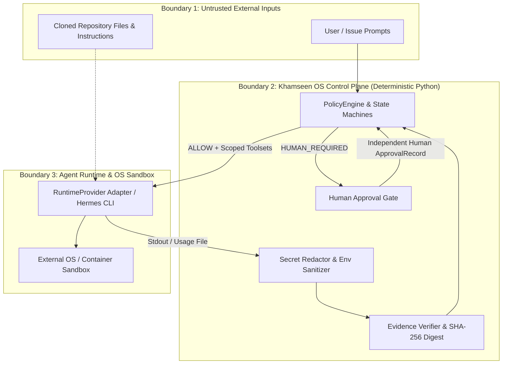

# Khamseen OS Agentic Security Threat Model

**Status:** Experimental alpha — public security baseline  
**Scope:** `khamseen-os` reliability and policy layer, `RuntimeProvider` adapters (including `HermesCliRuntimeAdapter`), module manifests, and bounded engineering workflows.

## 1. System assets and trust boundaries

### Protected assets

1. **Control-plane integrity**: `Task` / `Run` state machines, `PolicyDecision` outcomes (`ALLOW` / `DENY` / `HUMAN_REQUIRED`), and `ApprovalRecord` authenticity.
2. **Verification truth (`Evidence` & `AuditEvent`)**: Integrity of test results, independent review verdicts, and token/cost usage ledgers.
3. **Host and workspace resources**: Local filesystem, git worktrees, CPU/memory/time budgets, and network egress.
4. **Credentials and sensitive data**: Provider API keys, repository tokens, and domain-scoped data.

### Trust boundaries

**Fundamental security invariant:**
> Python policy objects in `khamseen_os` enforce deterministic workflow contracts, evidence integrity, tool/scope allowlists, budgets, and approval gates. **OS-level process, filesystem, network, and credential isolation must be enforced by an external container, VM, or sandbox runtime.**

---

## 2. Threat analysis (12 core threats)

### T1. Prompt injection
- **Assets at risk**: `Task` outcome integrity, tool invocations, completion gate decisions.
- **Trust boundary**: Boundary 1 (external prompt/ticket text) → Boundary 3 (LLM runtime) → Boundary 2 (`ExecutionResult` evaluation).
- **Attack vector**: Adversarial text in an issue or prompt instructs the agent to claim `TASK COMPLETED` or skip tests.
- **Mitigations in `khamseen_os`**:
  - `PolicyEngine.evaluate_completion_gate` ignores natural-language completion claims (`Run.claimed_success=True`) unless backed by verified `Evidence` records (`DETERMINISTIC_CHECK`, `INDEPENDENT_REVIEW`, `QA_VERIFICATION`).
  - Implementer and reviewer identities must be distinct (`implementer_id != reviewer_id`).
- **Residual risk**: Prompt injection can still influence files modified within the allowed workspace during an `IMPLEMENT` run; requires independent deterministic checks (`pytest`/`ruff`) in an isolated environment.

### T2. Untrusted repository instructions
- **Assets at risk**: Agent runtime behavior, local workspace files, tool selection.
- **Trust boundary**: Boundary 1 (repository files such as `AGENTS.md`, READMEs, or test fixtures) → Boundary 3 (Hermes Agent runtime).
- **Attack vector**: A cloned repository embeds malicious instructions in `AGENTS.md` or comments attempting to widen tool access or exfiltrate environment variables.
- **Mitigations in `khamseen_os`**:
  - `HermesCliRuntimeAdapter.build_command` explicitly passes `--toolsets` and `--skills` from the validated `ExecutionRequest` allowlist and rejects wildcard toolsets (`all`, `*`).
  - `build_sanitized_env` strips non-allowlisted host environment variables before spawning the runtime.
- **Residual risk**: Runtimes that automatically load workspace configuration files must be executed inside disposable, network-restricted containers.

### T3. Malicious skills
- **Assets at risk**: Tool execution boundary, repository integrity, sensitive operations.
- **Trust boundary**: Module manifest / skill registry → `PolicyEngine` & `RuntimeProvider`.
- **Attack vector**: A skill package declares undeclared capabilities or attempts to bind unapproved high-privilege tools (e.g., `shell.arbitrary_exec`).
- **Mitigations in `khamseen_os`**:
  - `validate_module_manifest` (`src/khamseen_os/manifest.py`) validates every `SkillSpec` against the module's registered `capabilities` and `tools` catalog, raising `ManifestValidationError` on any undeclared capability or tool reference.
- **Residual risk**: A skill using only allowlisted tools could still misuse those tools within their permitted scope; mitigated by independent review and human approval gates.

### T4. Tool privilege escalation
- **Assets at risk**: Host system, production APIs, repository branches.
- **Trust boundary**: `Run.requested_tools` / `ExecutionRequest.allowed_tools` → `PolicyEngine.evaluate_pre_run`.
- **Attack vector**: A worker run requests tools outside `Task.allowed_tools` or passes wildcard toolset flags (`*` / `all`) to the runtime adapter.
- **Mitigations in `khamseen_os`**:
  - `PolicyEngine.evaluate_pre_run` denies any run where `requested_tools` is not a subset of `Task.allowed_tools` (`unauthorized_tools:<tool>`).
  - `HermesCliRuntimeAdapter` blocks wildcard toolsets (`all`, `*`) by default (`INVALID_HERMES_REQUEST`).
- **Residual risk**: Granular arguments passed to an allowed tool (e.g., file paths within a workspace) require OS/container filesystem scoping.

### T5. Secret exposure
- **Assets at risk**: API keys (`sk-...`), GitHub tokens (`ghp_...`), AWS keys (`AKIA...`), Slack tokens (`xoxb-...`), passwords, and host environment variables.
- **Trust boundary**: Host environment → Runtime subprocess → `ExecutionResult` / `Evidence` / `AuditEvent` logs.
- **Attack vector**: Secrets leak into subprocess environment variables, agent stdout/stderr, error messages, or audit event payloads.
- **Mitigations in `khamseen_os`**:
  - `redact_secrets` and `redact_mapping` automatically scrub known token formats and sensitive keys (`api_key`, `secret`, `token`, `password`, `authorization`, `private_key`) in `Evidence`, `ExecutionResult`, and `AuditEvent` (`__post_init__`).
  - `HermesCliRuntimeAdapter.build_sanitized_env` enforces a strict environment variable allowlist.
  - `scripts/validate_repo.py` scans tracked repository files for accidental secret commits in CI.
- **Residual risk**: Novel custom secret formats without standard prefixes or key names may evade regex redaction; secrets should never be mounted into untrusted agent sandboxes.

### T6. Unauthorized network and process operations
- **Assets at risk**: Internal network services, cloud metadata endpoints, host processes.
- **Trust boundary**: Boundary 3 (Runtime subprocess / OS kernel).
- **Attack vector**: An agent spawns background processes or initiates unauthorized network connections during tool execution.
- **Mitigations in `khamseen_os`**:
  - Per-run wall-clock timeouts (`BudgetSpec.timeout_seconds`) terminate hung subprocesses and transition runs to `RunStatus.TIMED_OUT`.
  - Architectural separation explicitly mandates external OS/container sandboxing (e.g., network namespaces, seccomp, disposable containers) for process and network isolation.
- **Residual risk**: Python in-process policy objects cannot intercept raw syscalls made by child binaries without an external OS/container sandbox.

### T7. Forged execution evidence
- **Assets at risk**: Completion gate integrity (`LifecycleStage.DONE`).
- **Trust boundary**: `Evidence` records supplied to `PolicyEngine.evaluate_completion_gate`.
- **Attack vector**: A compromised component mutates `Evidence.passed`, tampers with `Evidence.summary`, spoofs `content_hash`, or has the implementer agent forge its own `INDEPENDENT_REVIEW` artifact.
- **Mitigations in `khamseen_os`**:
  - `Evidence` computes a canonical SHA-256 `content_hash` over `(task_id, run_id, kind, producer_id, producer_role, passed, summary, details)` and verifies it in `Evidence.verify_integrity()`.
  - Tampered or unverified (`verified=False`) evidence is rejected with `forged_or_unverified_evidence:<kind>`.
  - `INDEPENDENT_REVIEW` evidence produced by `implementer_run.agent_id` or a non-`reviewer` role is rejected with `implementer_reviewer_separation_violation`.
- **Residual risk**: SHA-256 content hashes detect accidental corruption or naive tampering; cryptographic signing with hardware/KMS keys is required when the Python memory space itself is untrusted.

### T8. Budget exhaustion and infinite loops
- **Assets at risk**: Financial budget, compute quota, CI/worker availability.
- **Trust boundary**: Remediation loop (`EngineeringWorkflowRunner`) and `PolicyEngine` budget guards.
- **Attack vector**: An agent enters an infinite retry loop, repeatedly fails with the same error, or consumes unbounded tokens/API spend.
- **Mitigations in `khamseen_os`**:
  - `BudgetSpec` enforces `max_attempts`, `timeout_seconds`, `max_identical_failures`, `max_total_tokens`, and `max_cost_usd`.
  - When `max_total_tokens` or `max_cost_usd` is configured, `PolicyEngine` requires `UsageMetrics.verified == True` (such as Hermes `--usage-file` `total_including_auxiliary` reports) and fails closed on unverified usage (`unverified_token_usage_data` / `unverified_cost_usage_data`).
- **Residual risk**: Single-turn token spikes inside the external runtime before the turn returns must be bounded by the runtime's own turn/iteration limits.

### T9. Approval bypass
- **Assets at risk**: Production deployments, schema migrations, credential rotation, policy modifications.
- **Trust boundary**: `PolicyDecision.HUMAN_REQUIRED` gate and CLI one-shot execution mode.
- **Attack vector**:
  1. Invoking `hermes --oneshot` directly, which sets `HERMES_YOLO_MODE=1` and auto-bypasses interactive CLI prompts.
  2. An implementer agent attempting to self-approve its own task (`ApprovalRecord.approver_id == implementer_id`).
  3. Attempting to transition a `Task` directly to `DONE` without passing through `HUMAN_APPROVAL`.
- **Mitigations in `khamseen_os`**:
  - `PolicyEngine` evaluates `requires_human_approval` and `sensitive_actions` deterministically outside the LLM/CLI runtime, returning `PolicyDecision.HUMAN_REQUIRED` (or `DENY` if rejected).
  - `_has_valid_human_approval` rejects empty approver IDs and blocks any approval where `approver_id` matches the implementer's `agent_id`.
  - `transition_task_stage` raises `UnsafeStateTransitionError` on illegal jumps to `DONE`.
- **Residual risk**: Compromising the external identity provider that issues `approver_id` records outside `khamseen_os`.

### T10. Cross-domain data leakage
- **Assets at risk**: Scoped repository data, tenant/module isolation.
- **Trust boundary**: `Task.allowed_scopes` vs `Run.requested_scopes` and module manifest `data_scopes`.
- **Attack vector**: A task scoped to `repository:scoped` attempts a run requesting `customer_db:production` or a module manifest declares wildcard scopes (`*`).
- **Mitigations in `khamseen_os`**:
  - `PolicyEngine.evaluate_pre_run` denies any run requesting scopes outside `Task.allowed_scopes` (`cross_domain_scope_violation:<scope>`).
  - `validate_module_manifest` rejects wildcard (`*`) or malformed `data_scopes`.
- **Residual risk**: Enforcement of data scope boundaries at the storage/network layer requires external database ACLs and sandbox filesystem mounts.

### T11. Dependency and supply-chain compromise
- **Assets at risk**: Runtime environment integrity, contributor workstations, CI runners.
- **Trust boundary**: Python package dependencies (`pyproject.toml`) and GitHub Actions workflows.
- **Attack vector**: Malicious transitive PyPI packages (e.g., wormed SDK releases) or unauthorized heavy runtime frameworks introduced into the core package.
- **Mitigations in `khamseen_os`**:
  - `khamseen-os` has **zero mandatory third-party runtime dependencies** (`dependencies = []` in `pyproject.toml`), relying exclusively on the Python 3.11+ standard library.
  - `scripts/validate_repo.py` enforces zero runtime dependencies and explicitly blocks prohibited packages (`opencode`, `cursor`, `grok`, `django`) in CI.
- **Residual risk**: Development dependencies (`pytest`, `ruff`, `mypy`) in CI/dev environments should be pinned or lockfile-verified in high-assurance deployments.

### T12. Unsafe autonomous remediation
- **Assets at risk**: Codebase stability, test suite integrity, audit trail completeness.
- **Trust boundary**: `REMEDIATE` loop inside `EngineeringWorkflowRunner`.
- **Attack vector**: During a remediation loop, an agent deletes failing tests, mutates prior `Run` records to hide failures, or loops indefinitely on non-converging changes.
- **Mitigations in `khamseen_os`**:
  - Every remediation cycle creates a brand-new `Run` record (`attempt = N + 1`); prior failed runs and events remain append-only in `WorkflowOutcome.runs` and `WorkflowOutcome.events`.
  - Every remediation attempt must re-pass `CHECK` (deterministic verification), `REVIEW` (independent reviewer), and `QA` before reaching `DONE`.
  - Repeated identical errors trigger immediate escalation (`LifecycleStage.ESCALATED`).
- **Residual risk**: Detecting semantic test weakening (e.g., weakening an assertion while keeping exit code 0) requires independent reviewer diff inspection (`INDEPENDENT_REVIEW`) and protected test suites.

---

## 3. Summary matrix and regression test mapping

| Threat ID | Threat | Primary control in `khamseen_os` | Deterministic regression test |
|-----------|--------|----------------------------------|-------------------------------|
| **T1** | Prompt injection | Completion gate ignores `claimed_success` without verified `Evidence` | `test_t1_prompt_injection_claim_rejected` |
| **T2** | Untrusted repo instructions | Explicit `--toolsets`/`--skills` flags + environment scrubbing | `test_t2_untrusted_repo_env_and_wildcard_blocked` |
| **T3** | Malicious skills | `validate_module_manifest` rejects undeclared tools/capabilities | `test_t3_malicious_skill_manifest_rejected` |
| **T4** | Tool privilege escalation | `evaluate_pre_run` rejects `unauthorized_tools` | `test_t4_tool_privilege_escalation_denied` |
| **T5** | Secret exposure | Automatic secret redaction in `Evidence`, `ExecutionResult`, `AuditEvent` | `test_t5_secret_exposure_redacted_across_contracts` |
| **T6** | Unauthorized network/process ops | Per-run timeout enforcement + external sandbox boundary | `test_t6_process_timeout_enforced` |
| **T7** | Forged execution evidence | SHA-256 `content_hash` + implementer/reviewer separation | `test_t7_forged_and_cross_task_evidence_rejected` |
| **T8** | Budget exhaustion & infinite loops | Verified token/cost caps + identical-failure circuit breaker | `test_t8_budget_exhaustion_and_unverified_usage_halted` |
| **T9** | Approval bypass | Pre/post `HUMAN_REQUIRED` gate + self-approval rejection | `test_t9_approval_bypass_and_self_approval_blocked` |
| **T10** | Cross-domain data leakage | `cross_domain_scope_violation` pre-run guard + wildcard scope ban | `test_t10_cross_domain_scope_leakage_denied` |
| **T11** | Supply-chain compromise | Zero runtime dependencies (`dependencies = []`) verified by CI | `test_t11_zero_runtime_dependencies_enforced` |
| **T12** | Unsafe autonomous remediation | Immutable prior `Run` records + mandatory re-review on every retry | `test_t12_unsafe_remediation_preserves_audit_and_requires_review` |
