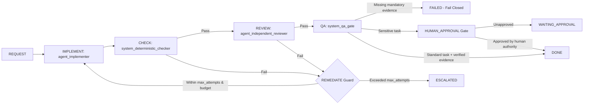

# Bounded Engineering Workflow Example

This example demonstrates Khamseen OS's core engineering workflow (`REQUEST → IMPLEMENT → CHECK → REVIEW → REMEDIATE → QA → DONE`) with a conditional `HUMAN_APPROVAL` gate using `FakeRuntime`.

It runs completely offline without API keys, external credentials, or network access.

## Workflow pipeline



## Scenarios covered

1. **`remediation_loop_to_done`** (`--scenario remediation`):
   - Attempt 1 fails independent review (`agent_independent_reviewer` rejects missing boundary check).
   - Enters `REMEDIATE` and spawns a new `Run` (Attempt 2).
   - Attempt 2 passes `CHECK`, `REVIEW`, and `QA`, completing as `DONE`.
2. **`sensitive_action_waiting_approval` & `sensitive_action_approved_done`** (`--scenario approval`):
   - Demonstrates how a task with `sensitive_actions=("policy.deployment.modify",)` pauses at `HUMAN_APPROVAL` (`WAITING_APPROVAL`) when unapproved, and transitions to `DONE` when a valid human `ApprovalRecord` is supplied.
3. **`bounded_max_attempts_escalation`** (`--scenario limit`):
   - Stops deterministically after `max_attempts=2` failed checks and transitions to `ESCALATED`.
4. **`fail_closed_on_missing_evidence`** (`--scenario fail-closed`):
   - Demonstrates that even when `FakeRuntime` reports `RunStatus.SUCCEEDED` and `claimed_success=True`, missing mandatory `Evidence` causes the completion gate to **fail closed** (`FAILED`).

## Commands to run

From the repository root:

```bash
python -m pip install -e ".[dev]"
python examples/engineering-loop/run_example.py
```

Run a single scenario or output JSON:

```bash
python examples/engineering-loop/run_example.py --scenario remediation
python examples/engineering-loop/run_example.py --scenario approval
python examples/engineering-loop/run_example.py --scenario limit
python examples/engineering-loop/run_example.py --scenario fail-closed
python examples/engineering-loop/run_example.py --json
```
